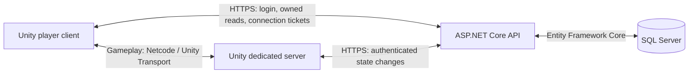

# ChillDuck · ProjectX

A multiplayer RPG built with Unity and ASP.NET Core, centered on combat, gathering, crafting and a persistent character progression loop. Players explore as ducks, collect equipment, complete quests, grow crops in a personal hideout and cooperate through parties and trading.

**ChillDuck** is the game name; **ProjectX** is the repository and code namespace. The long-term direction is a relaxed MMORPG. The current project is a development prototype focused on gameplay systems and persistence, with unfinished content, balancing and presentation.

[Features](#features) · [Architecture](#architecture) · [Technology](#technology) · [Run locally](#run-locally) · [Tests](#tests-and-validation) · [Repository layout](#repository-layout)

## Features

These systems are implemented in the repository; their presence does not imply production readiness or complete multiplayer validation.

| Area | Current implementation |
| --- | --- |
| Character and combat | Third-person movement, sword/bow/wand combat, character stats and experience, animated duck actions, hit feedback and a solo/party damage meter. |
| Equipment and inventory | Armor, weapons and compatible ammunition; item comparisons and Gear Score previews; potions and temporary buffs; drag/drop, splitting, merging and swapping stacks. |
| Items and storage | Enemy loot, merchant buy/sell, account-wide stash and saved action-bar bindings. |
| Quests | Kill and collection objectives, a quest journal, progress tracking, rewards, abandonment and reacceptance. Collection progress follows the items actually held. |
| Professions | Fishing, mining, woodcutting and herbalism; cooking, blacksmithing and alchemy recipes. |
| Hideout | Constructible buildings and a farm with seed slots, crop growth, harvesting and timed upgrades, including persisted offline progress. |
| Multiplayer | Persistent friends, private whispers, parties with shared enemy rewards, player-to-player trade and instanced solo/party dungeon travel. |
| Accounts and UI | Account authentication, session refresh, Polish/English localization, item tooltips and contextual window help. |

## Architecture

The game runs as three cooperating applications. The Unity dedicated server owns gameplay simulation; the API owns durable state and transactional changes. The player client sends actions and renders the results.



Local Development uses EF Core's in-memory provider by default. SQL Server is the durable storage option. Gameplay transport supports Direct connections and Relay/DTLS; the local automation selects Direct mode.

### Backend boundaries

The backend follows Clean Architecture, adapted from [Jason Taylor's template](https://github.com/jasontaylordev/CleanArchitecture):

- **Domain** — entities and I/O-free business rules, including inventory operations.
- **Application** — use cases, validation and interfaces for persistence and external services.
- **Infrastructure** — EF Core, Identity, JWT, localization and game-session adapters.
- **API** — Minimal API endpoints, authorization, error handling, OpenAPI and dependency composition.

Application depends on Domain; Infrastructure implements Application interfaces; API composes the system. Architecture tests enforce these boundaries.

### Engineering highlights

- **Authenticated admission.** A short-lived, one-time connection ticket binds the selected character to a server-side player session. Gameplay RPCs do not carry the player's JWT.
- **Atomic inventory operations.** Slots retain their positions, stacks have a fixed capacity, and an operation that cannot fit all resulting items saves nothing. Equipment and related character-state changes are persisted together.
- **Consistent quests and trading.** Collection progress is updated alongside inventory changes. A trade commits both inventories, affected collection objectives and an idempotency receipt together. Retrying an accepted trade does not apply it twice.
- **Explicit async lifetimes.** UI and network continuations belong to a particular player spawn. Accepted persistence work can outlive a disconnect, so despawning a player does not prematurely release a pending mutation.
- **Contract checks.** Tests cover OpenAPI, localization and layer dependencies alongside gameplay-related backend rules.

For examples, see the [trade use case](API/src/Application/CharacterInventories/Commands/TradeCharacterInventories/TradeCharacterInventories.cs), [server trade coordinator](Client/Assets/Scripts/Areas/Trade/Mono/TradeCommitCoordinator.cs) and [architecture tests](API/tests/Architecture.Tests/LayerDependencyTests.cs).

## Technology

| Layer | Main tools |
| --- | --- |
| Game client and server | C#, Unity **6000.1.15f1**, Universal Render Pipeline, Input System, Cinemachine, AI Navigation, uGUI/TextMesh Pro, UniTask |
| Networking | Netcode for GameObjects **2.4.4**, Unity Transport **2.5.3**, Unity Multiplayer Services, Direct / Relay |
| Backend | **.NET 10 / ASP.NET Core 10**, C# 14, Minimal APIs, MediatR, FluentValidation |
| Data and identity | Entity Framework Core 10, SQL Server, ASP.NET Core Identity, JWT |
| Diagnostics and contracts | Serilog, NSwag/OpenAPI |
| Validation and tooling | xUnit, Moq, architecture/contract tests, Unity editor probes, a .NET gameplay regression harness, PowerShell automation |

Version sources: [Unity editor](Client/ProjectSettings/ProjectVersion.txt), [Unity packages](Client/Packages/manifest.json), [.NET SDK](API/global.json) and [backend packages](API/Directory.Packages.props).

## Status and next steps

The project is under active development. The current focus is reliable gameplay and persistence across the client, dedicated server and API. The documented local workflow targets **Windows with keyboard and mouse**; gamepads are currently unsupported.

Known limitations include:

- Live authenticated two-client scenarios still need broader coverage, especially trade retries/disconnects, dungeon travel and remote combat delivery. Editor probes and compilation do not establish these behaviors.
- Relay deployment validation and long-running session-refresh tests remain outstanding.
- Game-session and connection-ticket state currently lives in one API process. Multiple API instances require a shared atomic store.
- Crafting still needs additional authoritative recipe/station validation. The prototype is not ready for untrusted public hosting.
- Art, content and economic balancing are evolving. Guilds and an auction house are planned, not implemented.

Feature-specific validation notes live in [Client/Automation](Client/Automation). They distinguish automated checks from manual and multiplayer scenarios that remain to be exercised.

## Run locally

### 1. Prerequisites

- Windows and PowerShell for the supplied startup scripts.
- Git, including access to the Git-hosted Unity package dependencies.
- Unity Hub and **Unity 6000.1.15f1**, with **Windows Dedicated Server Build Support** and a working Unity license.
- A stable **.NET 10 SDK** compatible with [API/global.json](API/global.json), which requests `10.0.300` with `latestFeature` roll-forward.
- SQL Server only if you opt out of the default in-memory Development database.

Clone the repository and add its `Client/` directory as a project in Unity Hub. Allow Unity to import assets and restore packages before running the game.

### 2. Configure the API once

From the repository root, in PowerShell:

```powershell
Set-Location API
dotnet tool restore
dotnet restore ProjectX.slnx
dotnet dev-certs https --trust

$jwtBytes = New-Object byte[] 64
$rng = [System.Security.Cryptography.RandomNumberGenerator]::Create()
$rng.GetBytes($jwtBytes)
$rng.Dispose()

dotnet user-secrets set "JwtSettings:SecurityKey" ([Convert]::ToBase64String($jwtBytes)) --project src/API/API.csproj
Set-Location ..
```

The signing key stays in local .NET User Secrets. Do not put it in tracked configuration.

**Development data is disposable.** [appsettings.Development.json](API/src/API/appsettings.Development.json) enables the in-memory database. Development startup intentionally deletes, recreates and seeds the configured database, including when SQL Server is selected. Use a dedicated development database: restarting the API resets progress. Non-Development startup does not initialize the database.

To use SQL Server for local development, set `UseInMemoryDatabase` to `false` and configure `ConnectionStrings:DefaultConnection` through User Secrets or environment variables. The same Development reset behavior still applies.

### 3. Start the stack

From the repository root:

```powershell
.\Client\Automation\run.bat
```

The script builds the API only if its executable is missing, starts it if needed, builds and starts a missing Unity dedicated-server process, and requests client Play Mode in the Unity editor. It reuses an already running API/server. The default API endpoint is `https://localhost:5001`, and the local server uses Direct transport.

At the login screen, use one of the local `Roles.Client` accounts defined in [the Development seed](API/src/Infrastructure/Persistance/ApplicationDbContextInitialiser.cs). The script supplies the seeded server account automatically; `PROJECTX_SERVER_USERNAME` and `PROJECTX_SERVER_PASSWORD` can override it. These seed accounts are for local development.

You can also use the Unity menu:

| Action | Purpose |
| --- | --- |
| `ProjectX > Build And Run` | Start the stack with a dedicated-server build when needed. |
| `ProjectX > Run` | Reuse an existing dedicated-server build. |
| `ProjectX > Build Dedicated Server` | Build the server separately. |
| `ProjectX > Play Client From Loading Scene` | Start client Play Mode separately, after the API and server are running. |
| `ProjectX > Open Bootstrap Scene` | Open BootstrapScene for inspection. |

Useful script options:

```powershell
# Reuse a previously built server.
.\Client\Automation\run.bat -SkipServerBuild

# Restart managed components and rebuild the Unity server; resets Development data.
.\Client\Automation\run.bat -RestartExisting

# Supply Unity's location if automatic discovery fails.
.\Client\Automation\run.bat -UnityPath "C:\Path\To\Unity.exe"
```

**After API changes:** stop the running API, rebuild it from `API/` with `dotnet build ProjectX.slnx`, then start the stack again. `-RestartExisting` does not force an API rebuild when its executable already exists.

Runtime logs are written under `Client/Logs/Runtime`; server builds go to `Client/Builds/Server`. Both are local generated output. The script's completion message means startup steps were issued; check logs and the client connection to confirm the game is ready. Startup implementation: [run.ps1](Client/Automation/run.ps1) and [ProjectXDevAutomation.cs](Client/Assets/Editor/ProjectXDevAutomation.cs).

For backend-only work, run the following from `API/`:

```powershell
dotnet run --project src/API/API.csproj --launch-profile ProjectX.API
```

The API's Development-only Swagger UI is available at [https://localhost:5001/api](https://localhost:5001/api). API-only startup does not start the game server or Unity client.

## Tests and validation

From `API/` after the configuration step above:

```powershell
dotnet build ProjectX.slnx
dotnet test ProjectX.slnx
dotnet format ProjectX.slnx --no-restore --verify-no-changes
```

The solution separates Domain and Application unit tests, Infrastructure integration tests, Web acceptance tests and Architecture tests. The current backend test suite uses in-memory persistence and in-process HTTP hosting; it does not require a running Unity server, external API or SQL Server. Debug builds regenerate the checked-in OpenAPI document through NSwag without initializing the database.

The Unity-side regression harness can run without opening Unity. From the repository root:

```powershell
dotnet run --project Client/Automation/InventoryRegression/InventoryRegression.csproj
```

It compiles selected production gameplay code with test substitutes to exercise inventory, gear, ammunition and trade/quest coordination. It does not simulate a complete networked game.

Unity-specific checks include editor validation tools and feature smoke-test checklists:

- [Inventory, equipment and persistence](Client/Automation/inventory-layout-smoke.md)
- [Quest journal](Client/Automation/quest-journal-smoke.md)
- [Damage meter](Client/Automation/damage-meter-smoke.md)
- [Duck movement, combat and animation](Client/Automation/duck-character.md)
- [Hideout and farming](Client/Automation/hideout-smoke.md)
- [Dungeon travel](Client/Automation/dungeon-smoke.md)

Unity C# changes need client and dedicated-server compilation where applicable, plus Unity import/Netcode processing. Real pointer interaction, timing, reconnects and multiplayer behavior require Play Mode or authenticated runtime checks; passing .NET tests alone does not cover them.

## Repository layout

```text
ProjectX/
├── API/
│   ├── src/
│   │   ├── API/                  HTTP endpoints, configuration and OpenAPI
│   │   ├── Application/          Use cases, ports and validation
│   │   ├── Domain/               Entities and business rules
│   │   └── Infrastructure/       Persistence, identity and adapters
│   └── tests/                    Tests grouped by responsibility
├── Client/                       Unity client and dedicated-server project
│   ├── Assets/
│   │   ├── Scripts/Areas/        Gameplay modules and their UI/network code
│   │   ├── Editor/               Build automation, authoring and validation
│   │   ├── Scenes/               Bootstrap, world and interface scenes
│   │   └── Prefabs/              Reusable gameplay and UI assets
│   ├── Automation/               Startup scripts, regression harness, smoke notes
│   ├── Packages/                 Unity package manifest and lock file
│   └── ProjectSettings/          Unity project configuration
├── docs/                         Networking and deployment notes
└── memory-bank/                  Maintainer context, decisions and known gaps
```

For deeper implementation context, see [system patterns](memory-bank/systemPatterns.md), [tooling notes](memory-bank/techContext.md) and [Relay/DTLS admission](docs/relay-dtls-tickets.md).

<!-- Maintainers: keep this overview aligned with meaningful feature, architecture,
setup and validation changes. Add screenshots only from actual gameplay, store
them under docs/images/, and describe what they show. Do not present generated
mockups or isolated validation renders as multiplayer gameplay. -->
